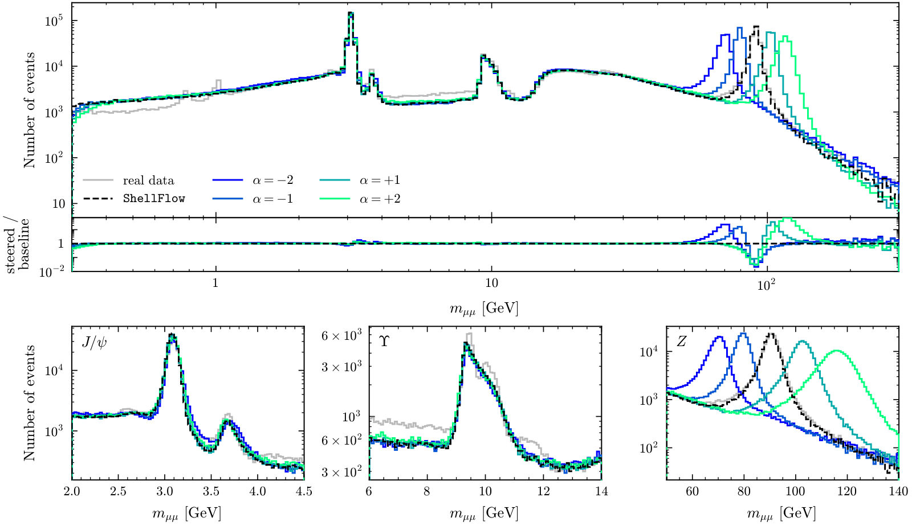
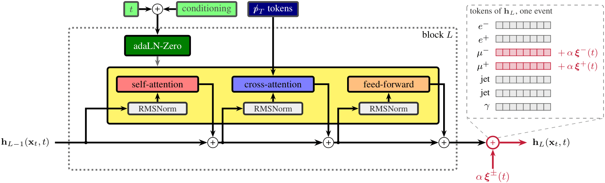
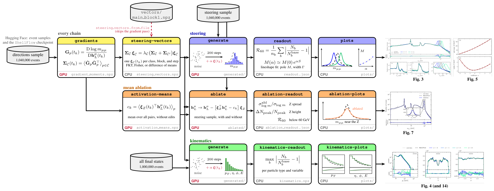
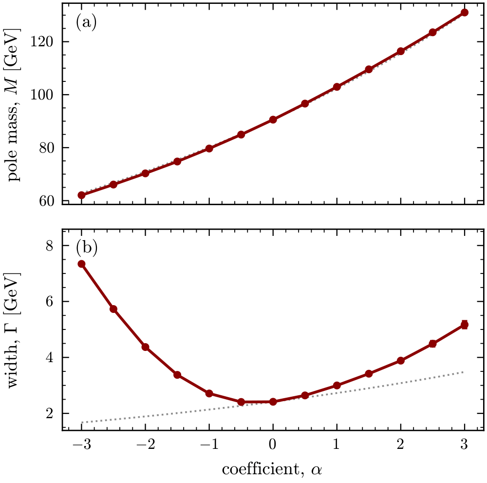
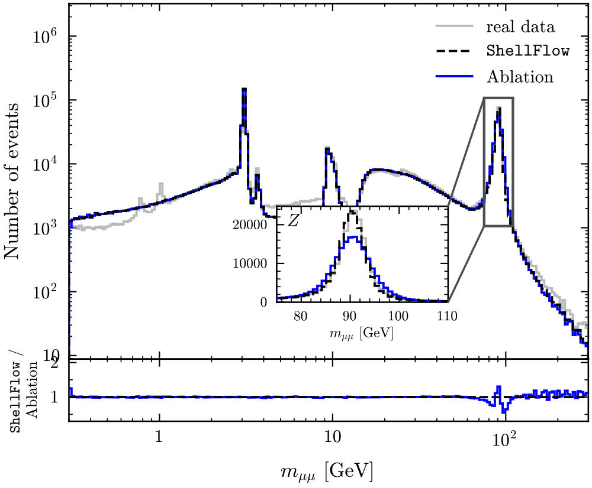
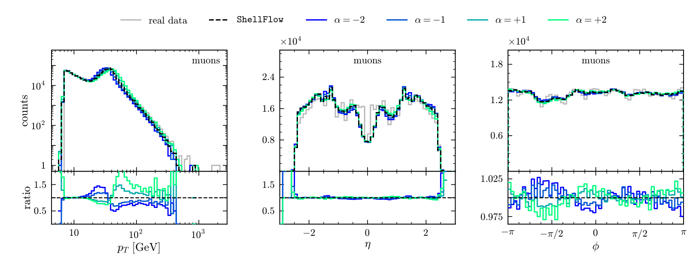

<div align="center">

# Discovering Z bosons inside of a neural network

[](https://arxiv.org/abs/TODO)
[](https://huggingface.co/pomidori73/ShellFlow)
[](https://huggingface.co/datasets/kurquia/shellsteer-events)
[](https://www.python.org/)



<sub>Dimuon invariant mass of one million muon pairs. Real data (grey), <code>ShellFlow</code> without edits (black, dashed), and the Z steering vector added at block 1 with α = −2, −1, +1, and +2 (blue to green). The Z peak moves, and the J/ψ and Υ peaks stay in place. Paper Fig. 3.</sub>

</div>

`shellsteer` finds steering vectors in the residual stream of `ShellFlow`, a flow-matching generator of LHC collision events trained on ATLAS open data, and generates events with them.
The Z steering vector moves the fitted pole of the Z from 62 GeV to 131 GeV for $\alpha$ from −3 to 3, while the rest of the dimuon spectrum changes little.
Ablating the same direction gives a Z peak about 18% broader.
This repository holds the code, the configs, and the steering vectors of the paper.

> [!NOTE]
> TODO: remove this note when the paper is on arXiv and the dataset is public.
> The paper link is a placeholder, and the event samples on Hugging Face are private until the release.

## What the code does

`ShellFlow` [[Kato et al. 2026](https://arxiv.org/abs/2607.16144)] generates the four-momenta of the particles of an event in 200 Euler steps.
Each particle is one token, and the network has six transformer blocks with a residual stream of width 128.
`shellsteer` adds a vector to the residual stream of the two muon tokens at the output of one block, at every Euler step:

$$\mathbf{h}_L^{\mu^\pm} \to \mathbf{h}_L^{\mu^\pm} + \alpha \boldsymbol{\xi}^{\pm}(t)$$

<p align="center">

<br>
<sub>One transformer block of <code>ShellFlow</code>. The steering vector goes into the residual stream at the output of the block, on the μ⁻ and μ⁺ tokens only. Paper Fig. 2.</sub>
</p>

The steering vector $\boldsymbol{\xi}(t)$ comes from the gradients of $\log m_{\mu\mu}$ with respect to the residual stream.
To first order, the edit shifts $\log m_{\mu\mu}$ of each pair by $\alpha$ times the dot product of $\boldsymbol{\xi}(t)$ with the gradient of that pair, summed over the 200 Euler steps (paper Sec. 4.1).
A vector that moves only the Z must therefore align with the gradients of pairs near the Z and not with the gradients of the other pairs.
The code finds it in four steps:

1. Generate one million muon pairs without edits, and sort them into classes by their generated mass: J/ψ, Υ, Z, and the rest (`configs/classes.yaml`).
2. Sum the second moments of the unit gradients of each class, for each block and Euler step.
3. Solve for the direction whose second moment is largest for the Z and smallest for the other classes, with a Fukunaga-Koontz transform (FKT). Fisher and difference-of-means directions are options.
4. Generate a second, separate set of one million pairs with and without the edit, from the same noise, so that each pair is compared with itself. Read the mass spectrum, $\mathcal{R}_{60}$ (the mean change of the spectrum below 60 GeV), and the pole $M$ and width $\Gamma$ of a fit of the Z lineshape.

The mean ablation removes the component of the residual stream along $\boldsymbol{\xi}_Z$ and adds back its mean over all pairs (paper Eq. 24).

<p align="center">

<br>
<sub>The stages of <code>steer</code>. Each chain is a separate run with its own config; all three start with <code>gradients</code> and <code>steering-vectors</code>. GPU stages use every visible GPU. The dashed arrow starts a run from the shipped steering vectors.</sub>
</p>

## Install

The package needs Python 3.13 or later and [uv](https://docs.astral.sh/uv/).
The network code comes from [pomidori/ShellFlow](https://github.com/pomidori/ShellFlow) at commit `2622c84`, pinned in `pyproject.toml`.

```bash
git clone TODO-repository-url
cd TODO-repository-name
uv sync
source .venv/bin/activate
```

`uv.lock` pins torch 2.10.0. The paper's runs used it with CUDA 12.8 on NVIDIA B200 GPUs.
The checkpoint and the event samples download from Hugging Face on the first run, at the revisions pinned in `configs/networks.yaml` and `configs/datasets.yaml`.

The event samples are private until the release, so set a Hugging Face token that can read them (TODO: delete this line when the dataset is public):

```bash
export HF_TOKEN=hf_...
```

## Quick start

### Reproduce Fig. 3 from the shipped steering vectors

`vectors/main_block1.npz` holds the paper's steering vectors at block 1 for the classes Z, J/ψ, Υ, and rest.
Start from it and the run skips the gradient pass. Run this from the repository root:

```bash
steer all configs/paper/main_z_block1.yaml \
    --set steering_vectors.from_file=vectors/main_block1.npz
```

The run generates 1,040,000 events five times, once without the edit and once for each $\alpha$ = −2, −1, +1, +2.
Each generation takes about 14 minutes on one B200, so the run takes about 70 minutes.
It writes to `runs/main_z_block1/`, and Fig. 3 is `runs/main_z_block1/plots/steered_spectrum.pdf`.
Each generated file is about 50 MB.

`readout.json` holds the fitted pole of each generation.
Our run of this config on a B200 gave these values for seed 2041:

| $\alpha$ | −2 | −1 | 0 | +1 | +2 |
|---|---:|---:|---:|---:|---:|
| Pole $M$ [GeV] | 70.30 | 79.67 | 90.58 | 102.97 | 116.42 |
| Width $\Gamma$ [GeV] | 4.39 | 2.70 | 2.41 | 3.00 | 3.86 |

### Run the full chain

Without `steering_vectors.from_file`, `steer all` first runs the gradient pass, about one hour on one B200:

```bash
steer all configs/paper/main_z_block1.yaml
```

`steer all CONFIG` runs every stage of the config in order.
`steer STAGE CONFIG` runs one stage, and the shell scripts in `examples/` list one command per stage.
The stages of the steering chain write these files to `runs/<name>/`:

| Stage | What it does | Writes | Device |
|---|---|---|---|
| `gradients` | Generates the directions sample without edits, keeps 1,000,000 pairs, and sums the unit gradients per class, block, and step | `gradient_moments.npz`, `directions_kept.npz` | GPU |
| `steering-vectors` | Solves for the steering vector of each class and block, or copies the file of `steering_vectors.from_file` after a check against the config | `steering_vectors.npz` | CPU |
| `generate` | Generates the steering sample without the edit and for each $\alpha$ and seed | `generated/seed_<seed>/alpha_<alpha>.npz` | GPU |
| `readout` | Computes $\mathcal{R}_{60}$, the shift of the Z, the selectivity curve, and the lineshape fits | `readout.json` | CPU |
| `plots` | Draws the steered spectrum (Fig. 3), the selectivity curve, and the pole and width against $\alpha$ (Fig. 5) | `plots/*.pdf` | CPU |

The kinematics chain (`all_muons.yaml`) runs `gradients`, `steering-vectors`, and `generate` as above, then two stages of its own.
Its `generate` stage keeps every particle of each event and writes no `generated/kept.npz`.

| Stage | What it does | Writes | Device |
|---|---|---|---|
| `kinematics-readout` | Counts $p_T$, $\eta$, $\phi$, and $E$ of every particle type for real data, the baseline, and each $\alpha$, and finds the largest change per bin | `kinematics.npz`, `kinematics_readout.json` | CPU |
| `kinematics-plots` | Draws the kinematics of the edited muons (Fig. 4) and of every other particle type (Fig. 14) | `plots/kinematics.pdf`, `plots/all_particles.pdf` | CPU |

The mean-ablation chain (`ablation_z.yaml`) runs `gradients` and `steering-vectors` as above, then four stages of its own.
With `steering_vectors.from_file`, its `gradients` stage writes only `directions_kept.npz`, because the mean of Eq. 25 needs the kept pairs.

| Stage | What it does | Writes | Device |
|---|---|---|---|
| `activation-means` | Sums the residual stream of the kept pairs per class, for the mean of Eq. 25 | `activation_means.npz` | GPU |
| `ablate` | Generates `ablation.sample` without edits and with the mean ablation (Eq. 24), for each seed | `ablated/seed_<seed>/baseline.npz`, `ablated/seed_<seed>/block_<L>.npz` | GPU |
| `ablation-readout` | Computes the spread and height of the target peak and the deviation below 60 GeV | `ablation_readout.json` | CPU |
| `ablation-plots` | Draws the baseline, the mean ablation, and real data (Fig. 7) | `plots/ablation.pdf` | CPU |

A stage refuses to run if the output of a stage it needs is missing or was made with other settings.
It also refuses to replace its own output unless you pass `--overwrite`.

## Configs

### Write a config

A config is one YAML file that holds every setting of a run.
To write one, copy the paper config closest to your run and edit it:

```bash
cp configs/paper/main_z_block1.yaml configs/paper/my_run.yaml
```

Give the run a new `name`. The run writes to `runs/<name>/`.
The paths in `networks`, `datasets`, and `classes` are relative to the config file, so update them if you put the config in another folder.

Every key is required.
`steer` reads the config with pydantic and stops on an unknown key, a missing key, a wrong type, or a value outside its options, with an error that names the key.
The comments in `configs/paper/main_z_block1.yaml` list the options of each key.

The sections of the config choose the chain:

| Chain | Sections | Example |
|---|---|---|
| Steering | `steering`, `readout`, `lineshape`, and `plots`; `events.dataset` holds muon pairs | `main_z_block1.yaml` |
| Kinematics | `steering` and `kinematics`; `events.steering_dataset` holds events of every final state | `all_muons.yaml` |
| Mean ablation | `ablation` and `readout`, without `steering` | `ablation_z.yaml` |

The keys you are most likely to change:

| To change | Key |
|---|---|
| The resonance | `target`: a class of `configs/classes.yaml`, `Z`, `Jpsi`, or `Upsilon`. The lineshape fit runs only for `Z`. |
| The mass windows of the classes | `configs/classes.yaml` |
| The block | `steering.block` (or `ablation.block`). A run with a gradient pass needs the block in `gradients.blocks`. |
| The method | `steering_vectors.method`: `fkt`, `fisher`, or `meandiff` |
| The coefficients and seeds | `steering.alphas` and `steering.seeds` |
| The tokens that get the edit | `steering.tokens`: `pair`, `minus`, `plus`, or `all_of_type` |
| The number of events | `events.directions`, `events.steering`, and `events.keep` |

### Paper configs

Each config in `configs/paper/` reproduces one part of the paper.
GPU times are for one B200, at about 14 minutes per generation of 1,040,000 events.
The gradient pass adds about one hour to a run that does not start from `vectors/main_block1.npz`.

| Config | Paper | Generations | GPU time |
|---|---|---:|---|
| `main_z_block1.yaml` | Sec. 5, Fig. 3 | 5 | 70 min from the shipped vectors |
| `main_z_block1.yaml` with the Fig. 5 overrides of the [next section](#change-settings-with---set) | Sec. 5.1, Fig. 5 | 39 | 9 h from the shipped vectors |
| `ablation_z.yaml` | Sec. 5.3, Fig. 7 | 6, plus 2 passes without edits for the mean of Eq. 25 | about 1.9 h from the shipped vectors, 2.6 h with the gradient pass |
| `all_muons.yaml` | Sec. 5.1, Fig. 4; App. D.1, Fig. 14 | 5 | about 70 min from the shipped vectors |
| `methods_z_fisher.yaml` | App. B, Figs. 9 and 10 | 27 | about 6.3 h, plus the gradient pass |
| `methods_z_meandiff.yaml` | App. B, Figs. 8 and 10 | 21 | about 4.9 h, plus the gradient pass |
| `blocks_z_block0.yaml`, `blocks_z_block3.yaml` | App. D.2, Figs. 15 and 16 | 39 each | about 9 h each, plus the gradient pass |
| `quarkonia_jpsi.yaml`, `quarkonia_upsilon.yaml` | App. D.4, Figs. 18 and 19 | 39 each | about 9 h each from the shipped vectors |

TODO: App. C, the steering of `ShellFlow-B` and `ShellGATr`, has no config yet.

Fig. 14 of the paper also shows the mass of jets, large-R jets, and hadronic taus.
`all_muons.yaml` draws every other column of Fig. 14 but not the mass column.

### Change settings with `--set`

Every setting lives in the config, and `--set key=value` overrides one key by its dotted path.
The value is read as YAML.
For example, this command reproduces Fig. 5, which needs 12 values of $\alpha$ and three seeds:

```bash
steer all configs/paper/main_z_block1.yaml \
    --set steering_vectors.from_file=vectors/main_block1.npz \
    --set 'steering.alphas=[-3, -2.5, -2, -1.5, -1, -0.5, 0.5, 1, 1.5, 2, 2.5, 3]' \
    --set 'steering.seeds=[2041, 2042, 2043]' \
    --set name=main_z_block1_fig5
```

That is 39 generations, about 9 hours on one B200.
Use `--set name=...` for each new set of settings, so that each run gets its own folder.

### Use several GPUs

The stages that run the network use every visible GPU, or the CPU if there is none.
To choose the devices, pass `--devices`:

```bash
steer all configs/paper/main_z_block1.yaml --devices cuda:0,cuda:1
```

Batch $i$ runs on device $i \bmod n$ with the noise seed of batch $i$.
On GPUs of one type, every output file is bit-identical to the file of a run on one of them.

## Results

### The pole moves, and the peak broadens

The fitted pole moves from 62 GeV at $\alpha = -3$ to 131 GeV at $\alpha = +3$, within 0.9 GeV of the first-order prediction.
A pure shift of $\log m_{\mu\mu}$ would scale the width by the same factor as the pole.
Instead, the width grows on both sides of $\alpha = 0$.
For $|\alpha| \le 1$, $\mathcal{R}_{60} < 0.04$.
At $\alpha = -2$ it is 0.112, and at $\alpha = +2$ it is 0.071.

<p align="center">

<br>
<sub>Fitted pole M (a) and width Γ (b) against α, steered at block 1. Dotted: the first-order prediction. Error bars: standard deviation over three seeds. Paper Fig. 5.</sub>
</p>

### The ablation broadens the Z peak

The mean ablation along $\boldsymbol{\xi}_Z$ at block 1 gives a Z peak about 18% broader, and the spectrum below 60 GeV stays within the sampling noise ($\mathcal{R}_{60} = 0.014$).
The same ablation along random directions broadens the Z peak by 1 to 4%.

<p align="center">

<br>
<sub>Mean ablation of the Z steering vector (blue), <code>ShellFlow</code> without edits (black, dashed), and real data (grey). Inset: the Z peak on a linear scale. Paper Fig. 7.</sub>
</p>

### The muon momenta follow the pole

The steering vector acts on the muon tokens, so the muon transverse momentum $p_T$ moves with the pole, around $M/2$.
On 1,000,000 events of every final state, with the vector added to every muon, $p_T$ changes by up to 32% per bin at $\alpha = -1$ and 49% at $\alpha = +1$.
The pseudorapidity $\eta$ changes by at most 5.4% per bin, and the azimuth $\phi$ by at most 2%.

<p align="center">

<br>
<sub>Muon p<sub>T</sub>, η, and φ with the Z steering vector at block 1 on every muon. Ratio panels: steered over baseline. Paper Fig. 4.</sub>
</p>

The figures in this README come from the paper.

## Reproducibility

Two outputs match the paper's runs bit for bit:

- On a B200, the generation without edits of the steering sample is identical, pair for pair, to the paper's for seeds 2041, 2042, and 2043.
- On one GPU type, repeated gradient passes give identical gradient sums and steering vectors. Four runs on B200 GPUs wrote files with the same md5.

Steering vectors computed again on another machine can differ in the last digits, because the number of BLAS threads changes the order of the sums.
On a 4-core machine the difference was up to 1e-12.
`vectors/main_block1.npz` holds the vectors of the B200 runs, so a run from that file needs no recomputation.

The sampler counts NaNs in the generated events.
The paper configs set them to 0, as the paper did (`sampler.on_nan: set_to_zero`).
Set `sampler.on_nan: stop` to stop the run at the first NaN instead.

## Data and models

| | Where | What it holds |
|---|---|---|
| Real data | ATLAS open data, 13 TeV proton-proton collisions of 2015 and 2016 [[ATLAS 2025](https://doi.org/10.7483/OPENDATA.ATLAS.B5M9.44TN)] | The source of every event. Released under CC0. |
| Training skims | 2to4lep [[doi](https://doi.org/10.7483/OPENDATA.ATLAS.ZXYW.FXJO)] and 1LMET30 [[doi](https://doi.org/10.7483/OPENDATA.ATLAS.KPYL.P0EE)] | The events `ShellFlow` was trained on. |
| Muon-pair samples | [kurquia/shellsteer-events](https://huggingface.co/datasets/kurquia/shellsteer-events): `directions-dataset.npz`, `steering-dataset.npz` | 1,040,000 validation events each, with one muon pair, the real four-momenta, and the real pair mass. The first gives the gradients and steering vectors, the second is steered (Figs. 3, 5, and 7). |
| All final states | [kurquia/shellsteer-events](https://huggingface.co/datasets/kurquia/shellsteer-events): `all-final-states-dataset.npz` | 1,000,000 validation events of every final state, with the real four-momenta (Fig. 4). |
| Network | [pomidori73/ShellFlow](https://huggingface.co/pomidori73/ShellFlow): `union_1LMET30_2to4lep/model.ckpt` | The `ShellFlow` checkpoint; residual-stream width 128. |
| Model code | [pomidori/ShellFlow](https://github.com/pomidori/ShellFlow) | The `ShellFlow` architecture, installed as a dependency. |
| Steering vectors | `vectors/main_block1.npz` in this repository | The steering vectors of the main text: Z, J/ψ, Υ, and rest at block 1, for each of the 200 Euler steps, with the gradient response per step. |

`configs/datasets.yaml` and `configs/networks.yaml` pin the Hugging Face commit of each file, so a run always loads the same files.

## Acknowledgements

We acknowledge the work of the ATLAS Collaboration to record or simulate, reconstruct, and distribute the Open Data used in this work, and to develop and support the software with which it was analysed.
The GPU compute came from the NVIDIA Academic Grant Program (NVIDIA A100) and from the UCloud interactive HPC system (NVIDIA B200), which the eScience Center at the University of Southern Denmark manages.
This work was supported by a research grant (VIL57416) from VILLUM FONDEN.

## Citation

If you use this code, cite the paper (TODO: arXiv id and authors):

```bibtex
@article{TODO,
  title         = {Discovering {$Z$} Bosons Inside of a Neural Network},
  author        = {TODO},
  year          = {2026},
  eprint        = {TODO},
  archivePrefix = {arXiv}
}
```

If you use `ShellFlow`, also cite:

```bibtex
@misc{kato-2026-shellflow,
  title         = {Learning {Standard Model} structure from {LHC} data with {Riemannian} flow matching},
  author        = {Kato, Midori and Urqu{\'i}a-Calder{\'o}n, Kevin A. and Timiryasov, Inar and Ruchayskiy, Oleg},
  year          = {2026},
  eprint        = {2607.16144},
  archivePrefix = {arXiv}
}
```

## License

MIT. See [LICENSE](LICENSE).
